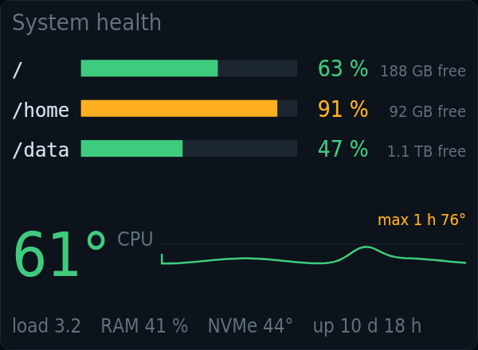

# kiosko-plugin-system

Machine vitals as a shared source, and a system health card.

A plugin for [Kiosko](https://github.com/kiosko-lcd/kiosko), the widget mosaic for small USB LCD panels.



## Install

In Kiosko, **Plugins → Install from npm** → `kiosko-plugin-system`, then restart Kiosko. Or from a terminal:

```sh
npm install --prefix ~/.config/kiosko/plugins kiosko-plugin-system
```

(macOS: `~/Library/Application Support/Kiosko/plugins`, Windows: `%APPDATA%\Kiosko\plugins`.)

## Requirements

- Works everywhere; CPU temperature and failed units are read on Linux only.

## Widgets

### System health — `system/health`

Disk usage, CPU temperature over the last hour, load, memory, uptime and failed systemd units of this computer.


| Option | Type | Default | |
|---|---|---|---|
| `mounts` | list | `[]` | Disks (mount points). Empty = every mounted disk (Linux) or the system disk. |
| `diskWarn` | number | `90` | Amber disk from |
| `diskAlert` | number | `95` | Red disk from |
| `tempWarn` | number | `65` | Amber CPU from |
| `tempAlert` | number | `80` | Red CPU from |
| `historyMs` | duration (ms) | `3600000` | Temperature history. How far back the CPU temperature line goes. |
| `onlyWhenWarning` | boolean | `false` | Only when something is wrong. Takes its turn only while a disk is amber or red, the CPU red, or a unit has failed. |
| `systemd` | boolean | `true` | Check failed systemd units |
| `rows` | number | `0` | Disk rows. 0 = as many as fit. A number shows that many, in rows of a readable size (fewer when the tile is too small for them); the rest are counted in "+N more". |

## Data sources

### Machine vitals — `system/vitals`

CPU usage per core, load, memory, CPU temperature (Linux), disk usage and uptime of this computer. Read every 5 s while a widget uses it. Options are set once in Kiosko → Settings → Data sources.

| Option | Type | Default | |
|---|---|---|---|
| `diskPath` | string | `"/"` | Disk to watch. Any path on it, e.g. / or /home. |

## Development

```sh
npm install
npm test          # node:test
npm run check     # TypeScript
npm run build     # dist/index.js, what Kiosko loads
```

To try it in a running Kiosko without publishing: `kiosko plugins link .` and restart Kiosko.

Working on Kiosko and its plugins together: clone them side by side
(`kiosko/` and `kiosko-plugins/kiosko-plugin-system/`) and run `npm install` in
`kiosko/`; its workspaces link every plugin found in `../kiosko-plugins`.

## License

MIT
